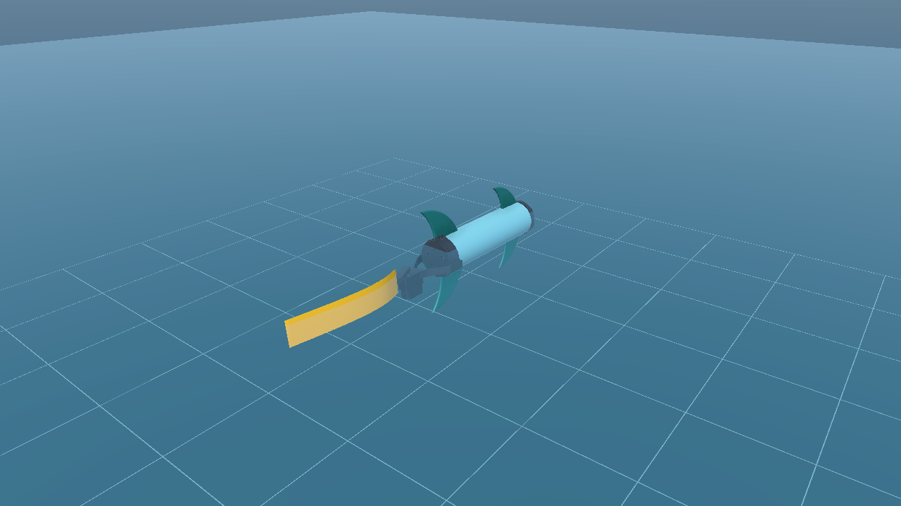
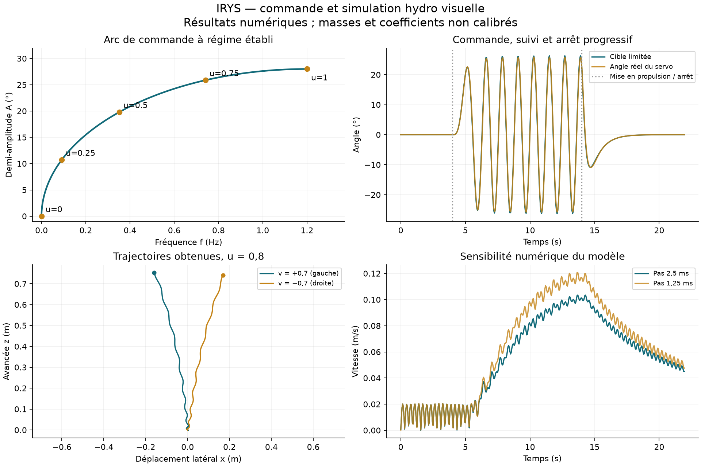

# Simulation hydro IRYS — branche simu-hydro

Ouvrir le projet `Unity_robot` du dossier de travail `irys-simu-hydro` avec **Unity 6000.6.5f1**, puis **Assets/Scenes/SimulationHydro.unity** et Play. Le projet principal et ses changements locaux sont conservés dans `irys-team-repo`.

- Haut/bas ou W/S : augmenter/diminuer `u` (la valeur reste mémorisée).
- Gauche/droite ou A/D : `v` signé ; relâcher ramène progressivement la consigne moyenne à zéro.
- Espace : demander l'arrêt ; amplitude et fréquence décroissent progressivement.
- Pour une entrée externe, désactiver `keyboard` sur `IRYS_Hydro > HydroRobot`, puis affecter les champs `u` et `v`. L'inspecteur permet également de les saisir pendant Play.

Le HUD affiche les entrées, la fréquence, la demi-amplitude, l'angle moyen filtré, la cible et l'angle réel du servo, la limite instantanée de couple et la vitesse du robot. Les paramètres matériels sont centralisés dans `Assets/HydroSimulation/RobotHydroDefinition.cs`. La scène ne fait pas varier les dimensions ou les matériaux en cours de simulation.

## Transformation f(u,v)

Entrées : `u ∈ [0,1]`, intensité de propulsion ; `v ∈ [-1,1]`, virage (positif = gauche dans les essais). Amplitude A = **demi-amplitude** en degrés, fréquence f en Hz, angle moyen en degrés.

La transformation est dynamique : ses deux filtres ont une mémoire. Pour un pas dt :

```
u_f ← u_f + (clamp01(u) − u_f) (1 − exp(−dt / 0,8 s))
alpha_moy ← alpha_moy + (25° clamp(v, −1, 1) − alpha_moy) (1 − exp(−dt / 0,65 s))
theta = π u_f / 2
A = 28° sin(theta)
f = 1,2 Hz (1 − cos(theta))
alpha_desire = alpha_moy + A sin(phase)
phase ← phase + 2 π f dt
```

L'arc satisfait `(A / 28°)² + (1 − f / 1,2 Hz)² = 1`. Ses bornes et les temps de filtrage se modifient dans le code. Un écrêtage de sécurité réduit A si nécessaire pour respecter la course et réserver de la vitesse au virage. Avec la référence actuelle, l'arc entier reste admissible.

La cible envoyée au servo suit ensuite une loi à vitesse et accélération limitées (300°/s et 1 800°/s²). La phase reste continue pendant les changements de fréquence. L'arrêt ne replace pas brutalement la palme au neutre.

`u` est une **commande d'intensité**, pas une puissance en watts. L'arc ne garantit ni une puissance mécanique linéaire en u, ni une vitesse du robot linéaire en u. Une calibration en puissance nécessiterait un bilan de couple/vitesse et des essais supplémentaires. Le couple et les charges peuvent empêcher le servo de suivre exactement (f,A,alpha_moy).

## Palme PVC et définition fixe

Référence : **350 × 70 × 1 mm**, PVC rigide, flexion latérale passive. La configuration à 3 mm s'obtient en changeant `TailThickness` et en reconstruisant la scène ; le matériau garde le même module effectif. La géométrie n'est pas ajustable dans le HUD.

Observation utilisateur : bande de 1 mm, encastrée à une extrémité et libre sur 300 mm, flèche d'environ 50 mm sous son propre poids. Avec une densité supposée de 1 400 kg/m³ et un modèle de poutre à petite déformation :

```
delta = q L⁴ / (8 EI)
q = rho b e g ; I = b e³ / 12
E = 3 rho g L⁴ / (2 e² delta) ≈ 3,337 GPa
```

C'est une identification effective approximative : la flèche est déjà assez grande pour limiter la précision du modèle linéaire. La largeur s'élimine du calcul. L'identification utilise toujours l'essai à **1 mm**, même si la simulation passe à 3 mm. À matériau identique, 3 mm donne 27 fois la rigidité EI et 3 fois la masse ; la flèche sous poids propre est donc environ 9 fois plus faible, et non 27 fois.

La palme est représentée par six sections avec ressorts de flexion dérivés de EI et amortissement basé sur une estimation d'inertie aval. Ces amortissements sont des choix de simulation, pas une mesure du PVC. Le rendu est un maillage continu interpolé entre les sections. Le modèle représente la flexion latérale dans le plan du battement ; il ne représente pas la torsion ou la flexion verticale de la palme installée.

Les quatre ailerons fixes utilisent **les maillages CAO originaux et leur implantation source**, sans génération de nouvelles formes. Les autres pièces visuelles proviennent aussi de la scène source. Les scripts hydro acceptent d'autres maillages fermés, mais aucune nouvelle forme n'est inventée dans cette référence.

## Eau, masses et actionneur

- Eau calme à Y=0, densité 1 000 kg/m³. Le courant est paramétrable sur `HydroRobot`.
- Coque : enveloppe cylindrique étanche de 400 mm, diamètre 110 mm. Volume de flottabilité indépendant des éléments internes. Immersion continue par cellules locales, volume total normalisé sur le volume analytique du cylindre.
- Ailerons : découpe des triangles à la surface ; pression normale sur les faces amont, frottement tangentiel, volume immergé et centre de carène calculés sur les maillages fermés.
- Palme : pression et frottement sur les surfaces des sections, poids et flottabilité de la matière PVC. Les efforts hydro produisent les couples sur les articulations ; aucune force de propulsion directe n'est ajoutée au robot.
- Les efforts de traînée sont dissipatifs par rapport au courant. Les résultantes et moments sont agrégés avant leur application, sans changer leur point d'action équivalent.
- Gravité native appliquée une fois. Le corps de 3,25 kg inclut par hypothèse les équipements et les ailerons fixes ; support mobile du servo de 66 g et palme d'environ 34,3 g ajoutés séparément. Ces masses, le centre de masse et les inerties restent à remplacer par des mesures. La masse n'est pas ajustée automatiquement pour rendre le robot neutre.
- D955TW à 7,4 V : couple de blocage 2,844 N·m et vitesse à vide 500°/s. Source fabricant : https://www.hiteccs.com/actuators/product-details/D955TW . Course retenue ±60° : hypothèse de montage. Le couple disponible diminue avec la vitesse en entraînement suivant une approximation linéaire ; ce n'est pas un modèle électrique/thermique et le couple de blocage n'est pas un couple continu admissible.
- Les articulations souples utilisent des drives du solveur, avec raideur, amortissement, limites et inerties explicites. Pas physique retenu : 2,5 ms ; 24 itérations de position et 12 de vitesse.

Le modèle vise un mouvement visuellement crédible. Il ne calcule pas de CFD, de sillage, de décrochage dynamique, de masse ajoutée ou de slamming. Les détails extérieurs de coque sont regroupés dans son enveloppe hydro ; les surfaces internes ne reçoivent pas de traînée d'eau.

## Vérifications et reproduction

Fermer l'éditeur de ce projet avant les commandes batch. Depuis `Unity_robot` :

```bash
/path/to/Unity -batchmode -nographics -projectPath "$PWD" -executeMethod HydroValidation.Run -quit -logFile /tmp/irys-hydro-validation.log
```

Les rapports et CSV sont enregistrés dans `Documentation/HydroValidation` : repos, propulsion et arrêt, deux virages opposés, commande maximale et comparaison au demi-pas. Les contrôles portent aussi sur l'arc, la course, le budget de vitesse, les filtres, la dissipation et les volumes immergés. Ils ne constituent pas une validation expérimentale du robot.

Le menu **IRYS > Hydro > Construire la scène de référence** assemble la scène à partir de `SampleScene`. Il refuse d'écraser une scène déjà présente. Après un changement des dimensions matérielles, sauvegarder la scène courante, la retirer de son chemin de référence, puis reconstruire ; modifier seulement les constantes sans reconstruire laisserait les masses/liaisons de la scène précédente.

Le dossier de travail utilise un checkout partiel : les textures volumineuses de piscine, les images documentaires et le fichier Blender de piscine n'ont pas été téléchargés. Ils ne sont pas nécessaires à `SimulationHydro`, qui utilise les maillages OBJ et ses matériaux propres. Le dossier `Modèles/materials` de la piscine est renommé `PoolMaterials` avec conservation des GUID pour résoudre son conflit de casse avec `Materials` dans Unity.

## Résultats de la référence du 4 novembre 2026

Les six essais numériques passent. À u=0,8, après 4 s au repos, 10 s de propulsion puis 8 s d'arrêt progressif, l'avancée est de 1,088 m ; ce chiffre est une sortie du modèle et ne prédit pas la vitesse matérielle. En fin d'essai, les deux dernières secondes présentent au maximum 0,222° de flexion relative entre sections : les oscillations de palme s'éteignent. Le robot continue sa décélération inertielle.

Avec v=+0,7 et v=−0,7, les virages sont de signes opposés. La commande maximale u=v=1 reste stable : angle servo maximal 51,7° pour une course de ±60°, vitesse de cible maximale 205,2°/s et accélération maximale 1 547,3°/s², sous les plafonds de 300°/s et 1 800°/s². Les amplitudes du robot au repos restent faibles (environ 3,3 mm de pilonnement crête à crête sur les deux dernières secondes).

Le déplacement passe de 1,088 m à 1,234 m en divisant le pas de 2,5 ms par deux, soit **11,9 % d'écart** par rapport au calcul fin. La convergence est suffisante pour cette démonstration visuelle, pas pour un dimensionnement. Le premier essai à 5 ms avait environ 20 % d'écart et a conduit au choix de 2,5 ms.

Un contrôle supplémentaire de **8 s en mode Play natif** passe : initialisation, FixedUpdate, rendu de palme dans LateUpdate et accès aux maillages fonctionnent sans erreur de simulation. L'import de `aileron.obj` active Read/Write, nécessaire au calcul hydro à l'exécution. Le rechargement standard de scène/domaine au Play est rétabli pour démarrer chaque essai avec un état propre.

L'éditeur Unity 6000.6.5f1 a aussi émis une exception de son indexeur `UnityEditor.Search.SearchDatabase` pendant le batch. Elle est distincte des scripts hydro et conservée dans le journal batch ; le contrôle Play la distingue des erreurs de simulation.



[Vidéo de 15 s à 25 images/s](HydroValidation/demo.mp4) : repos, propulsion, virage et arrêt progressif. Les repères de fond sont espacés de 50 cm. La vidéo est un export hors écran à cadence fixe, pas une mesure des performances temps réel.



Pour reproduire les figures et la vidéo, depuis la racine du dépôt :

```bash
python3 Tools/plot_hydro_validation.py
python3 Tools/render_hydro_preview.py --unity /chemin/vers/Unity
```

Le premier script nécessite NumPy et matplotlib, le second Unity avec un affichage graphique disponible et FFmpeg. Pour refaire uniquement le contrôle Play natif :

```bash
/path/to/Unity -batchmode -nographics -projectPath /chemin/vers/Unity_robot -executeMethod HydroPlaySmoke.Run -logFile /tmp/irys-hydro-play.log
```

Cette dernière commande s'arrête automatiquement après le contrôle ; ne pas ajouter `-quit` pendant l'entrée asynchrone en Play.
