# irys-team-repo

## Members

- Gaspard DELPIANO--MANFRINI
- Mateo BRUN
- Noé CARRAYROU
- Eliaz YAHIA
- Clement SARTRE
- Lancelot RAMIS

## Présentation et objectifs

L’exploration de grottes sous-marines pose des difficultés d’accessibilité, de visibilité, de
communication et de sécurité. Le projet vise la conception d’un démonstrateur compact de locomotion
biomimétique, susceptible de préfigurer une solution spécialisée pour les milieux confinés.

Les objectifs de cette première réalisation sont la propulsion par nageoire caudale oscillante, le
contrôle du tangage par translation d’une masse interne, la mesure de profondeur et d’attitude, ainsi
que l’enregistrement d’images et de données expérimentales.

## Environnement 3D

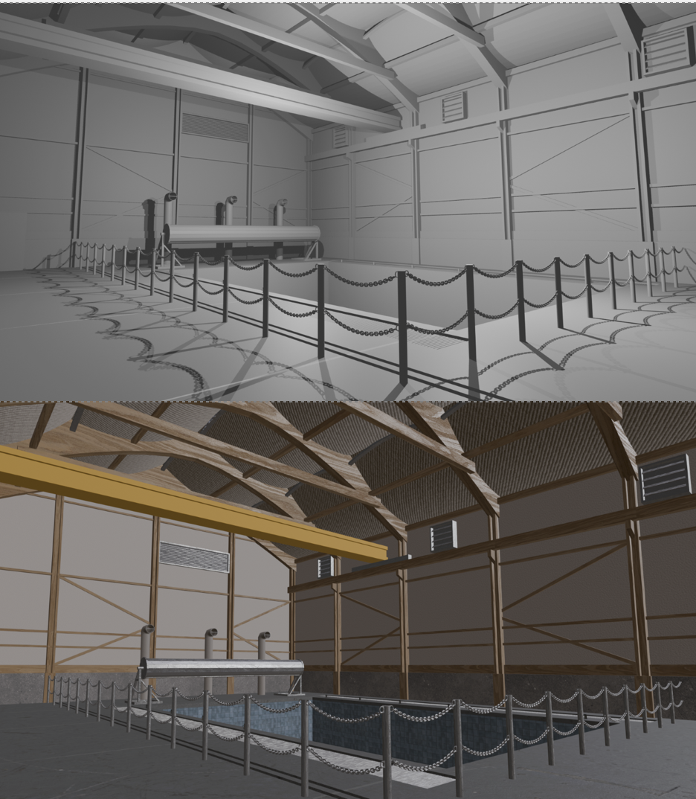

Bassin d'expérimentation de L'ENSTA modélisé en 3D sur Blender, puis exporté sur Unity.

## Simulation Unity

Le robot est simulé sous forme d'un corps articulé

voir [README Unity](Unity_robot/READMEUnity.md) pour plus de détails sur la simualtion Unity

## Architecture logicielle

Architecture logicielle désirée du contrôle du robot.
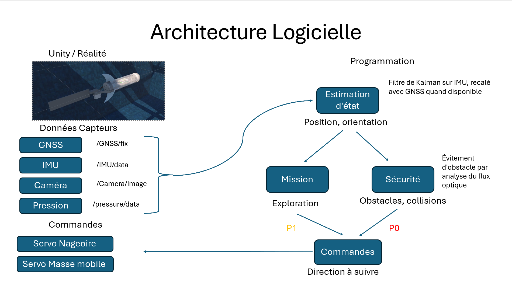

Schéma des connexions des noeuds ROS de contrôle du robot:
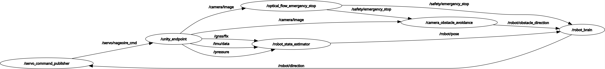

voir [README ROS](ROS/workspace/src/READMEROS.md) pour plus de détails sur le fonctionnement des nœuds ROS.

## Schéma électrique

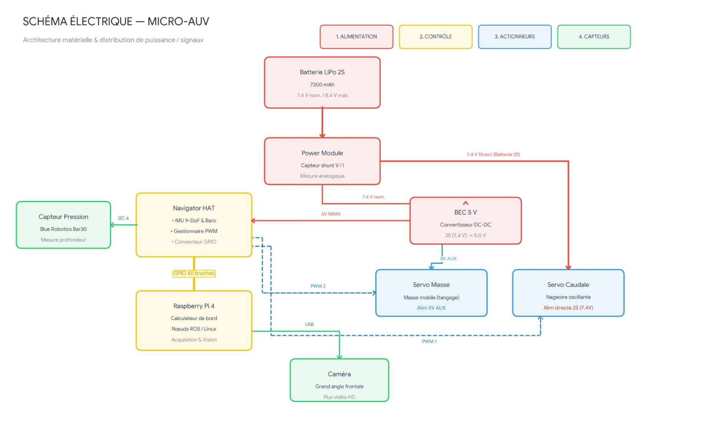

## Les pièces de CAO

### Bras de transmission du servomoteur nageoire

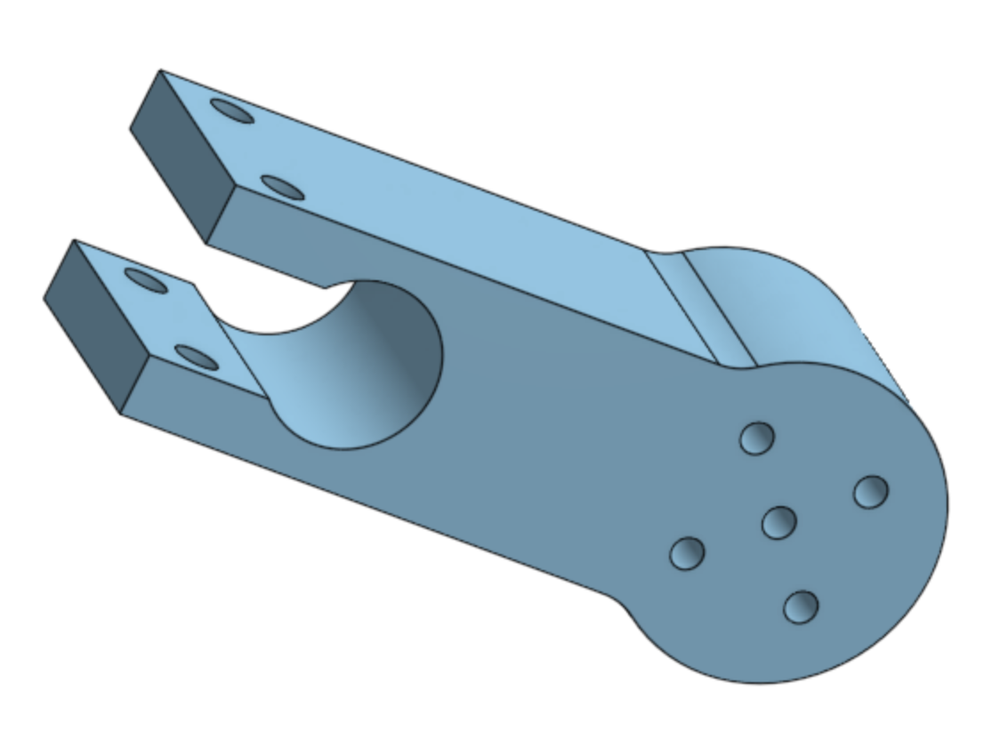
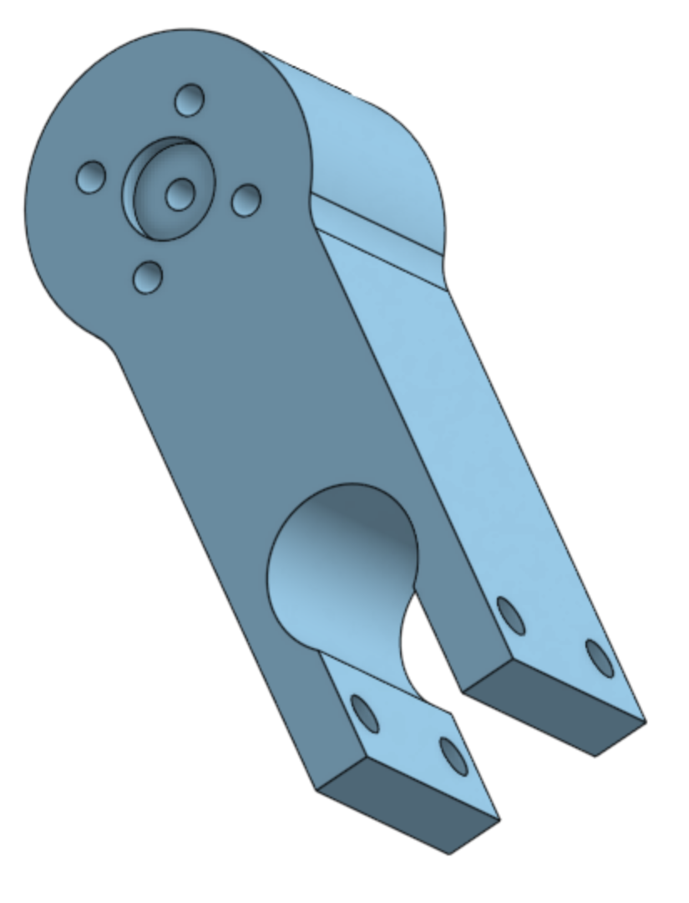

### Platine de fixation de la nageoire

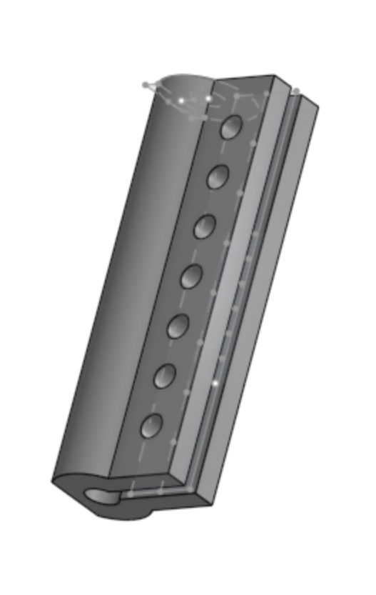
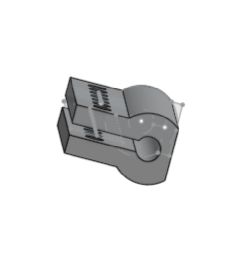

### Support servomoteur nageoire

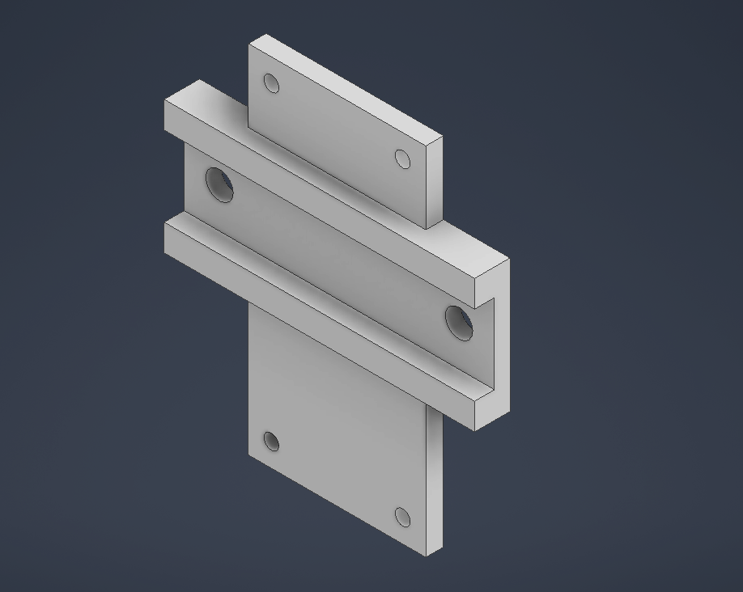
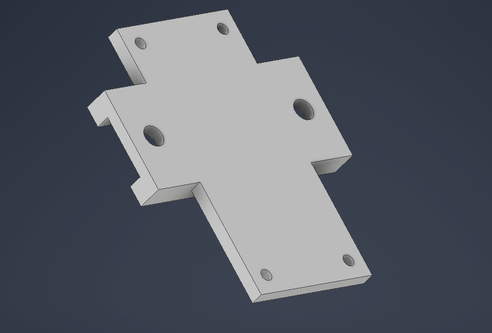

### Support masse mobile

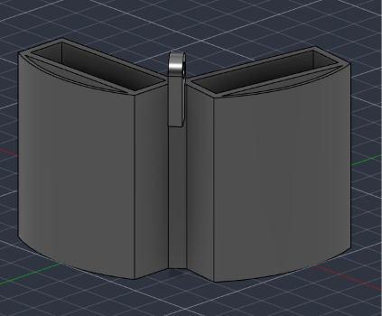
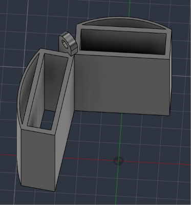

# Hardware

## Schéma électrique

## Connection à la raspberrypi

La connection ne fonctionne que sur mon partage de connexion ou par ethernet. Je pense que l'adresse mac de notre raspberrypi s'est fait ban du réseau iot.

Pour se connecter à la raspberry pi, brancher d'abord la raspberrypi et connectez votre client au partage de connexion Pixel_4952. Enfin, exécuter dans le shell :

`ssh irysbot@pi4.local`

puis rentrer le mdp : irys112

# Les problèmes

Mateo Brun, responsable soudure, en a trop marre des ses erreurs de ses collègues. En effet, celui ci a du ressouder les calbes aux powers module et a du aussi déssouder les cables du servomoteur pour faire passer le pénétrateur :

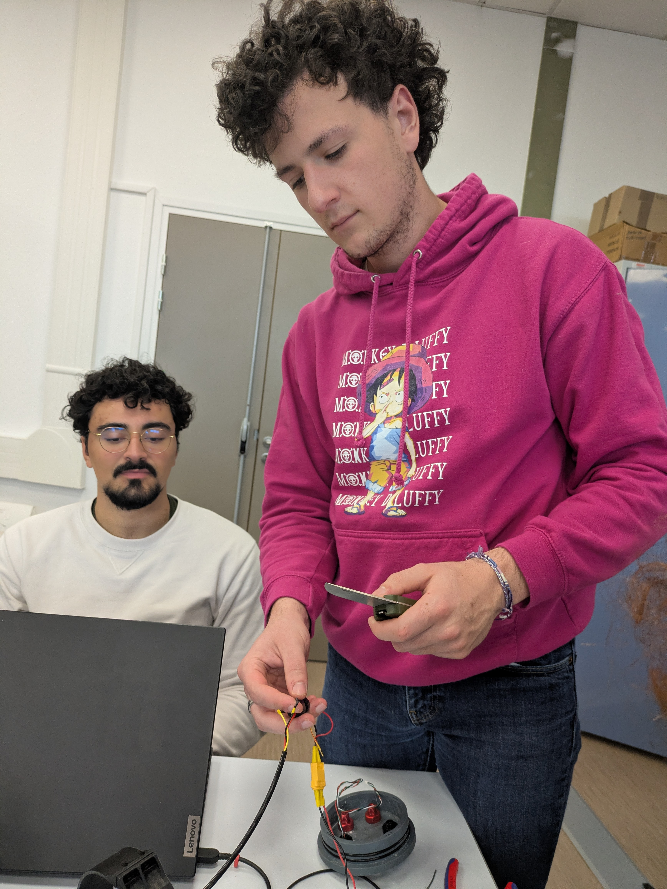

