# irys-team-repo

Simulation hydro sur `simu-hydro` : ouvrir `Unity_robot/Assets/Scenes/SimulationHydro.unity`. [Commande u/v, hypothèses et validation](Documentation/SIMU_HYDRO.md).

## Members

- Gaspard DELPIANO--MANFRINI
- Mateo BRUN
- Noé CARRAYROU
- Eliaz YAHIA
- Clement SARTRE
- Lancelot RAMIS

## Présentation et objectifs

L’exploration de grottes sous-marines pose des difficultés d’accessibilité, de visibilité, de
communication et de sécurité. Le projet vise la conception d’un démonstrateur compact de locomotion
biomimétique, susceptible de préfigurer une solution spécialisée pour les milieux confinés.

Les objectifs de cette première réalisation sont la propulsion par nageoire caudale oscillante, le
contrôle du tangage par translation d’une masse interne, la mesure de profondeur et d’attitude, ainsi
que l’enregistrement d’images et de données expérimentales.

## Environnement 3D

<p align="center">
  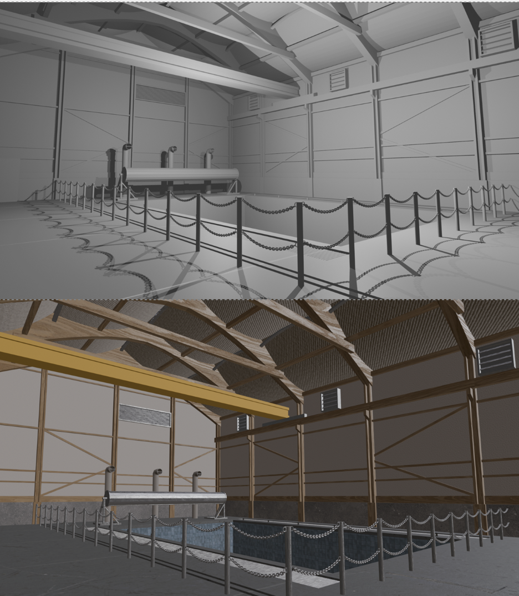
</p>

Bassin d'expérimentation de l'ENSTA modélisé en 3D sur Blender, puis exporté sur Unity.

## Simulation Unity

Le robot est simulé sous forme d'un corps articulé. Voir le [README Unity](Unity_robot/READMEUnity.md) pour plus de détails sur la simulation Unity.

<p align="center">
  <a href="videos/simulation_unity.mp4">
    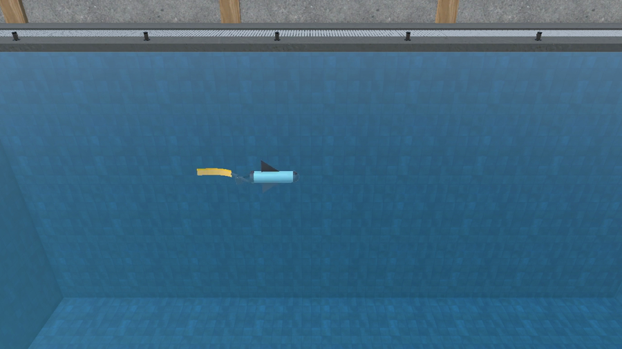
  </a>
  <br>
  <em>Simulation Unity du robot dans le bassin de l'ENSTA (cliquer pour lire la vidéo).</em>
</p>

### Modélisation dans les simulations

Deux versions de la simulation coexistent : `modif-unity` (scène `SampleScene`, branche `modif_unity`) et `sim-hydro` (scène `SimulationHydro`, branche `simu-hydro`).

| Critère | modif-unity | sim-hydro | Ce que ça apporte |
| --- | --- | --- | --- |
| Moteur physique | `ArticulationBody`, pas de 20 ms | `ArticulationBody`, pas de 2,5 ms | Pas de temps 8 fois plus fin |
| Traînée | 6 panneaux de nageoire, Cd = 150 (réglage de scène) | 6 faces par élément (coque, ailerons, palme), Cd = 1,8 | Coefficients physiques, tout le robot |
| Archimède | non activée par défaut | corps et ailerons | Flottaison et tangage |
| Palme | nageoire rigide articulée | 6 articulations élastiques amorties | Palme souple (PVC) |
| Servo | consigne ±`angleMax` | couple D955TW et vitesse limités | Limites réelles du servo |
| Commande | angles ROS ou flèches | loi u (poussée) et v (virage), filtrée | Pilotage par deux paramètres |
| Masse mobile | oui (prismatique ±0,1 m) | non | Pas de réglage d'assiette |
| ROS | oui | non | Pilotage au clavier seulement |
| Masse ajoutée | non | non | Absente des deux |
| Validation | aucune | scène recette, pas de mesure | Toujours à valider sur le robot |

Détails de la loi de commande et des hypothèses de `sim-hydro` : [SIMU_HYDRO.md](Documentation/SIMU_HYDRO.md).

## Essais de nage en bassin

Essais du robot dans le bassin de l'ENSTA (cliquer sur une vignette pour lire la vidéo, versions compressées).

<table align="center">
  <tr>
    <td align="center">
      <a href="videos/essai_nage_ailerons_horizontaux.mp4">
        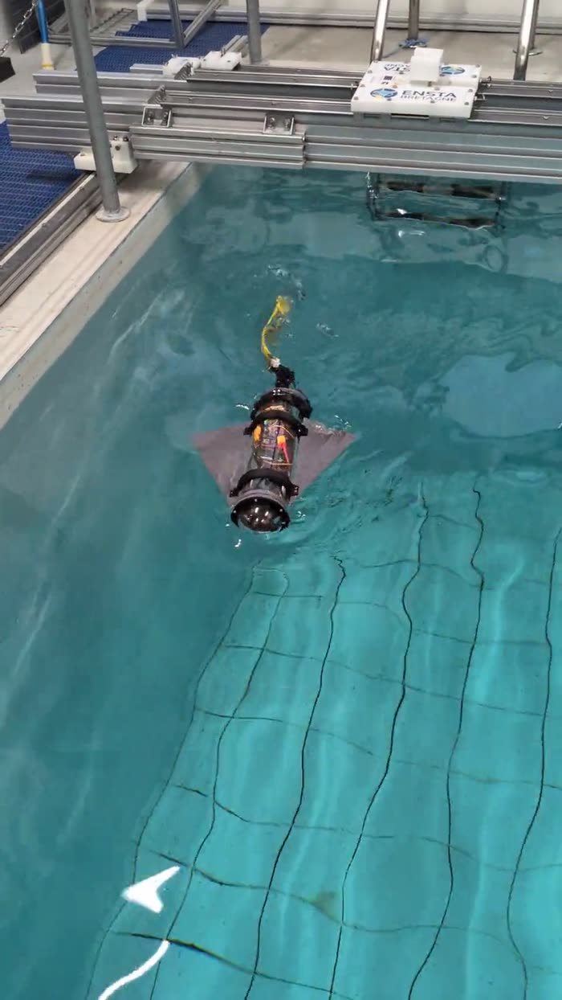
      </a>
      <br>
      <em>Ailerons horizontaux</em>
    </td>
    <td align="center">
      <a href="videos/essai_nage_ailerons_verticaux.mp4">
        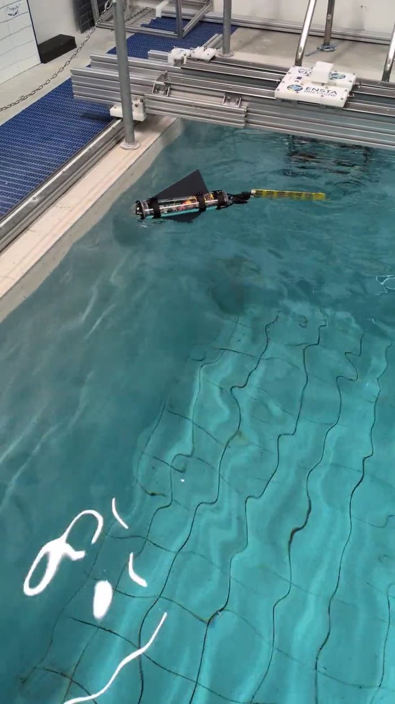
      </a>
      <br>
      <em>Ailerons verticaux</em>
    </td>
  </tr>
</table>

## Architecture logicielle

Architecture logicielle désirée du contrôle du robot :

<p align="center">
  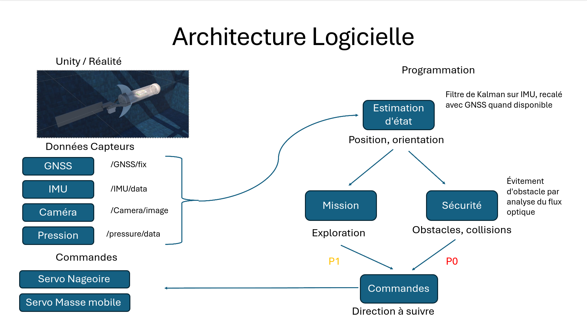
</p>

Schéma des connexions des nœuds ROS de contrôle du robot :

<p align="center">
  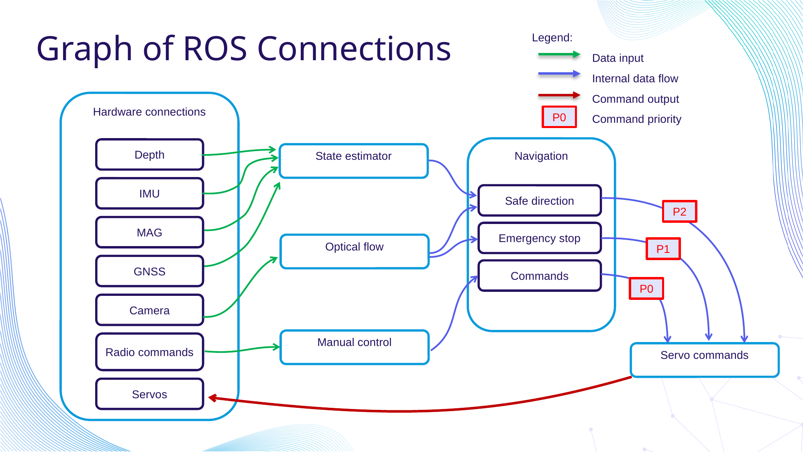
</p>

Voir le [README ROS](ROS/workspace/src/READMEROS.md) pour plus de détails sur le fonctionnement des nœuds ROS.

## Schéma électrique

<p align="center">
  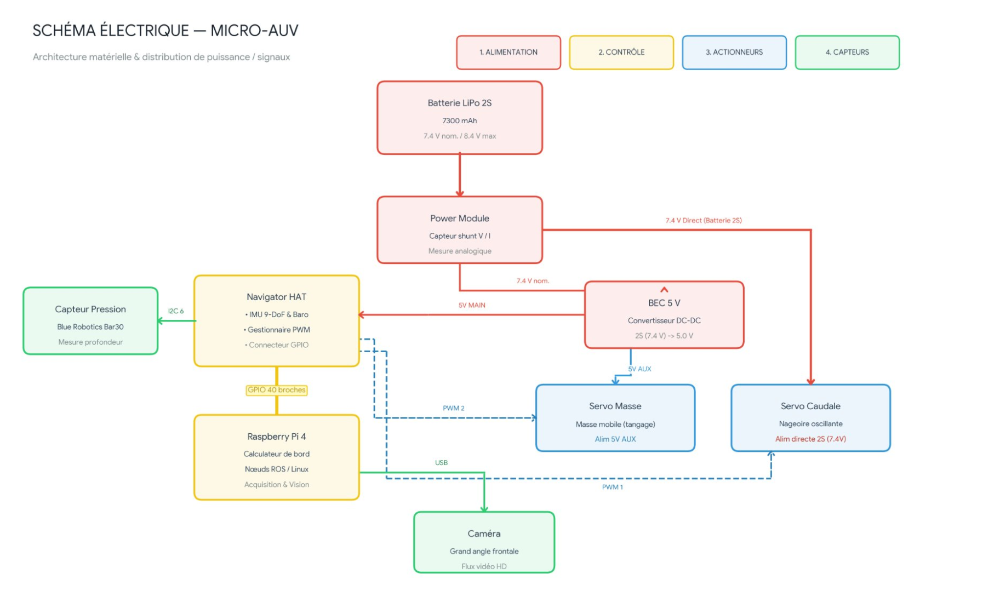
</p>

## Les pièces de CAO

### Bras de transmission du servomoteur nageoire

<p align="center">
  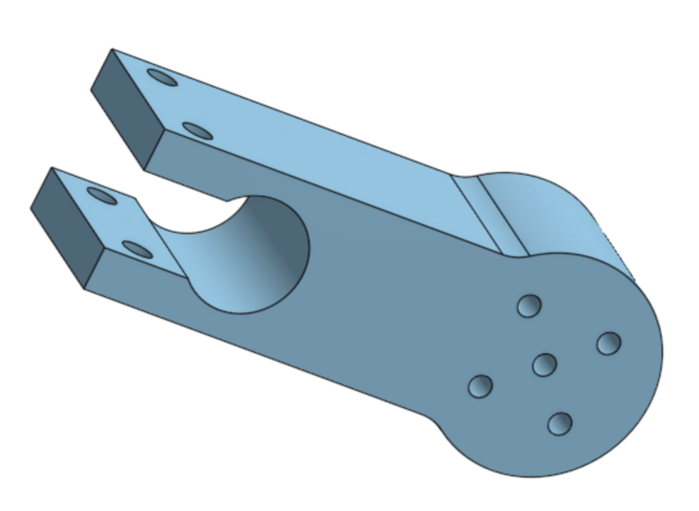
  &nbsp;&nbsp;
  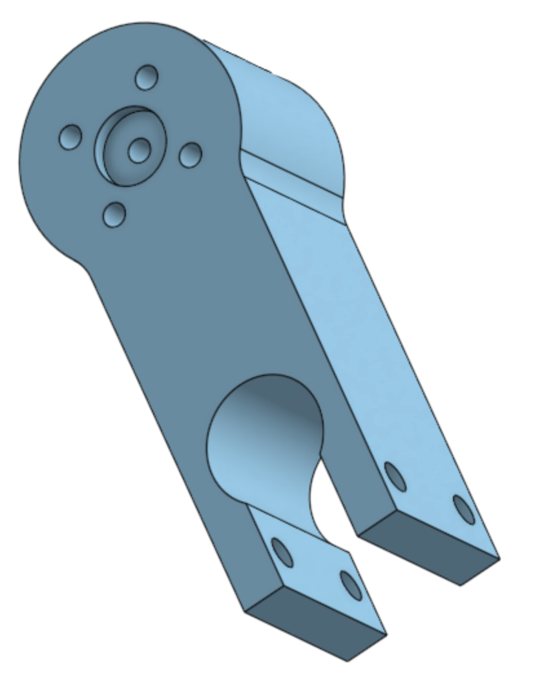
</p>

### Platine de fixation de la nageoire

<p align="center">
  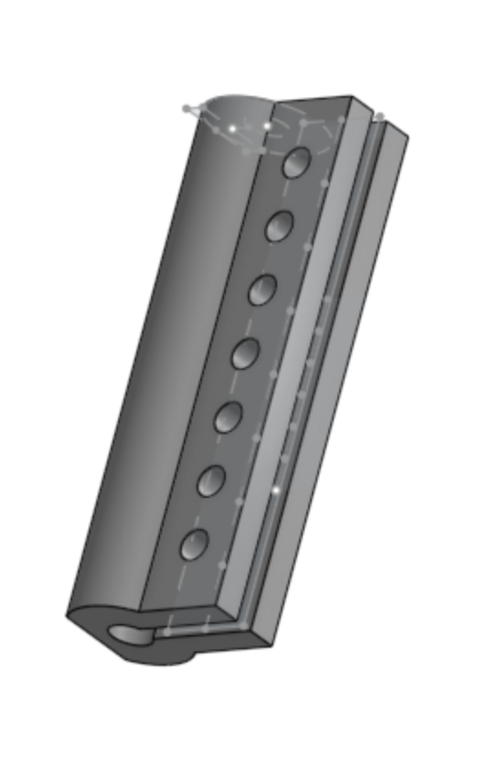
  &nbsp;&nbsp;
  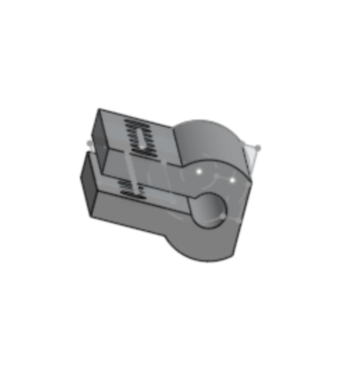
</p>

### Support servomoteur nageoire

<p align="center">
  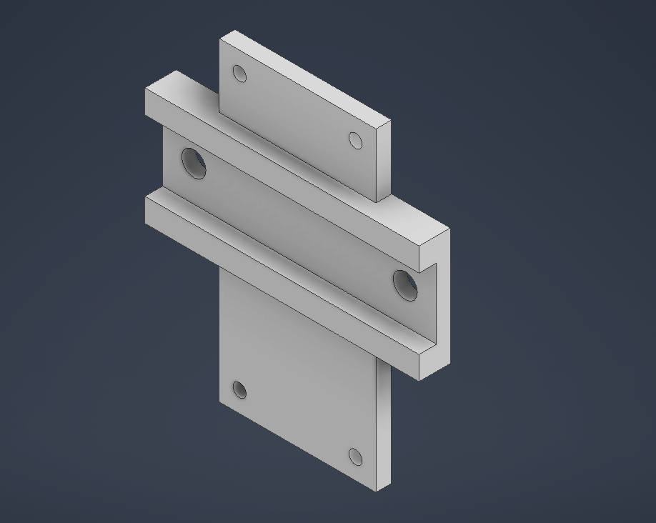
  &nbsp;&nbsp;
  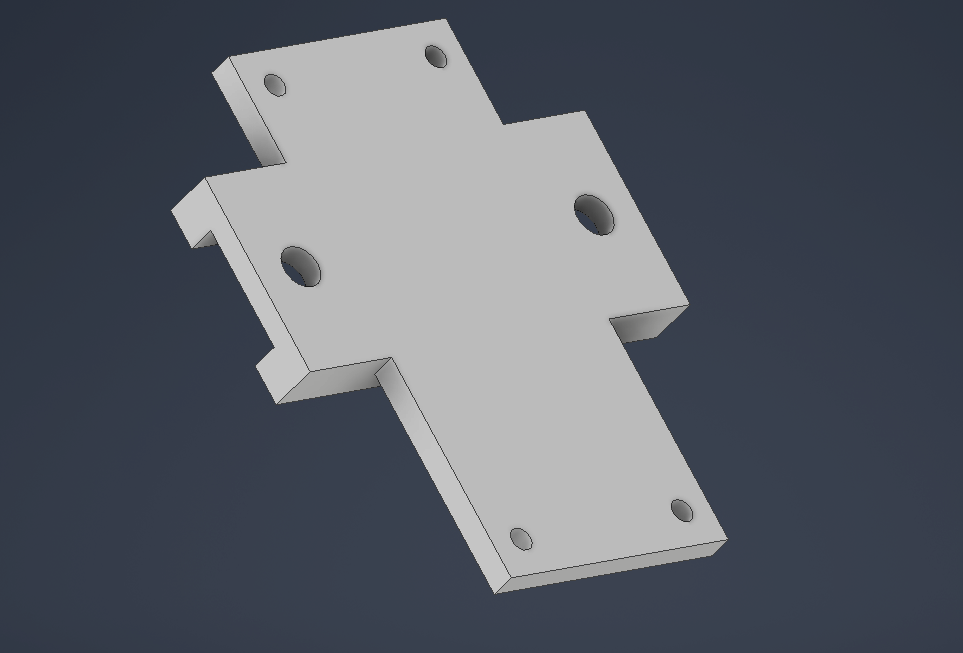
</p>

### Support masse mobile

<p align="center">
  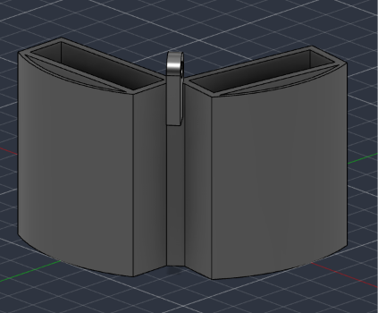
  &nbsp;&nbsp;
  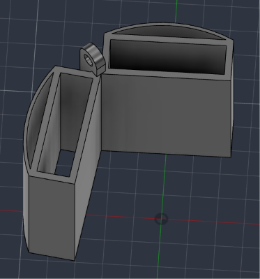
</p>

## Hardware

### Connexion à la Raspberry Pi

La connexion ne fonctionne que sur mon partage de connexion ou par ethernet. Je pense que l'adresse MAC de notre Raspberry Pi s'est fait bannir du réseau IoT.

Pour se connecter à la Raspberry Pi, la brancher d'abord, puis connecter votre client au partage de connexion Pixel_4952. Enfin, exécuter dans le shell :

```bash
ssh irysbot@pi4.local
```

puis rentrer le mot de passe : `irys112`
